# WakeSafe

> Hackachusetts submission

**WakeSafe looks at a person's sleep data from a wearable and a short health questionnaire, and tells them whether it is worth talking to a doctor about sleep apnea (and a few other health patterns).**

It is a **screening aid only**. It never tells anyone they have a condition. It says things like "estimated risk: Moderate" and "consider discussing this with a clinician", and it shows exactly which numbers led to that result.

> WakeSafe is a screening aid, not a diagnosis. Results come from wearable-style data and self-reported history, and must be confirmed by a clinician.

All demo data in this repository is **synthetic** (made up). No real patient data is used anywhere.

---

## Contents

1. [What you can do in the app (with screenshots)](#1-what-you-can-do-in-the-app)
2. [How a result is produced](#2-how-a-result-is-produced)
3. [Safety rules built into the code](#3-safety-rules-built-into-the-code)
4. [The data: synthetic people and real recordings](#4-the-data)
5. [The model, and its honest limits](#5-the-model-and-its-honest-limits)
6. [Run it yourself](#6-run-it-yourself)
7. [API reference](#7-api-reference)
8. [Repository layout and who owns what](#8-repository-layout)
9. [Tests](#9-tests)
10. [What is not built yet](#10-what-is-not-built-yet)
11. [Future work](#11-future-work)

---

## 1. What you can do in the app

The app has five pages: **Overview**, **Sleep Trends**, **Health Intake**, **Find Care** and **My Report**. A picker at the top right lets you try 72 made-up people, each with a made-up name ending in "(synthetic)" (see [section 4](#4-the-data)).

### Overview: your result at a glance

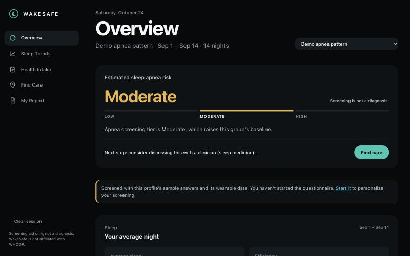

This is the first thing you see. From top to bottom:

| What you see | What it means |
| --- | --- |
| **Estimated sleep apnea risk: Moderate** | The screening tier: **Low**, **Moderate** or **High**. It is an estimate, never a yes or no. |
| The three-segment bar (LOW, MODERATE, HIGH) | Where the result sits. The current tier is highlighted. |
| "Screening is not a diagnosis" | Shown on every result. |
| One-line reason | In plain words, why this tier. |
| **Next step** and **Find care** | What to do next. The app only ever suggests talking to a clinician. |
| Yellow notice | Says what the result was built from. Here it used the demo person's sample answers and wearable data, and invites you to answer the questionnaire to personalize it. |

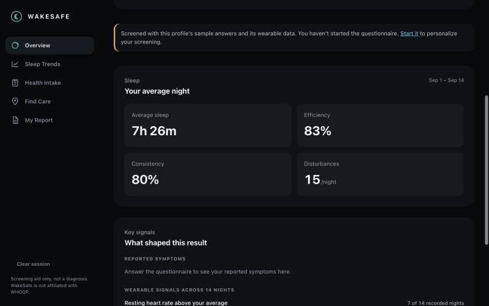

**Your average night** shows four numbers averaged over the data window (here 14 nights): average sleep, sleep efficiency (the share of time in bed spent asleep), consistency (how regular your sleep times are) and disturbances per night. These come straight from the wearable. Nothing is invented: if a night has no reading, the app shows "No data recorded", never a zero.

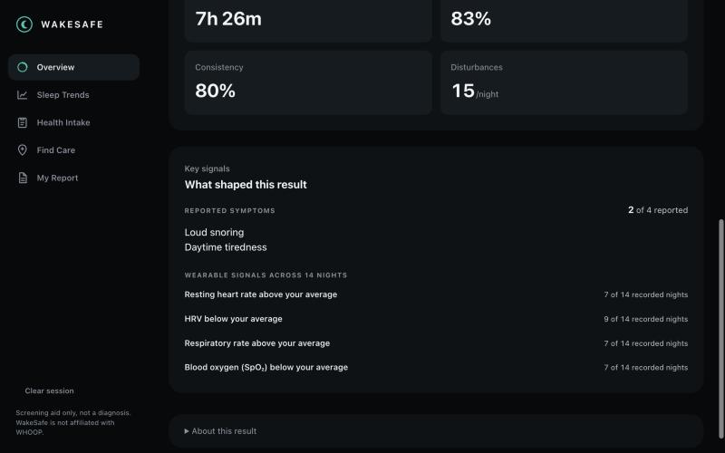

**What shaped this result** is split into two honest halves:

- **Reported symptoms**: what the person told us in the questionnaire (snoring, daytime tiredness, and so on).
- **Wearable signals**: how many of the recorded nights looked different from this person's own usual. For example "Blood oxygen (SpO2) below your average: 7 of 14 recorded nights".

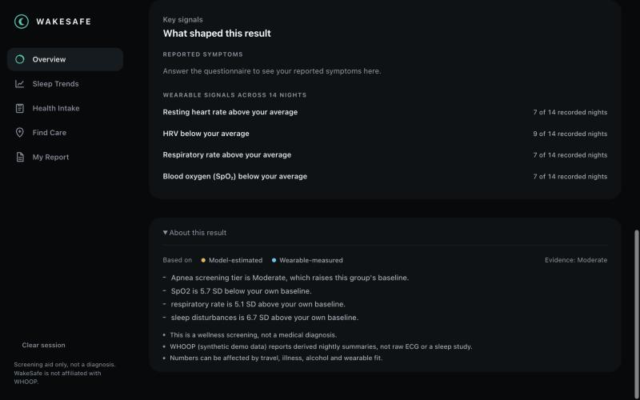

**About this result** (click to open) lists every reason with its number, for example "SpO2 is 5.7 SD below your own baseline" (SD means standard deviation, a measure of how unusual a change is). It also shows:

- **Based on**: which kinds of information were used (wearable-measured, model-estimated, patient-reported).
- **Evidence**: how strong the evidence is for this kind of risk (Weak, Weak to moderate, Moderate or Strong).
- **Limits**: for example that wearables report summaries, not raw medical recordings, and that travel, illness and alcohol change the numbers.

### Sleep Trends: see the pattern over time

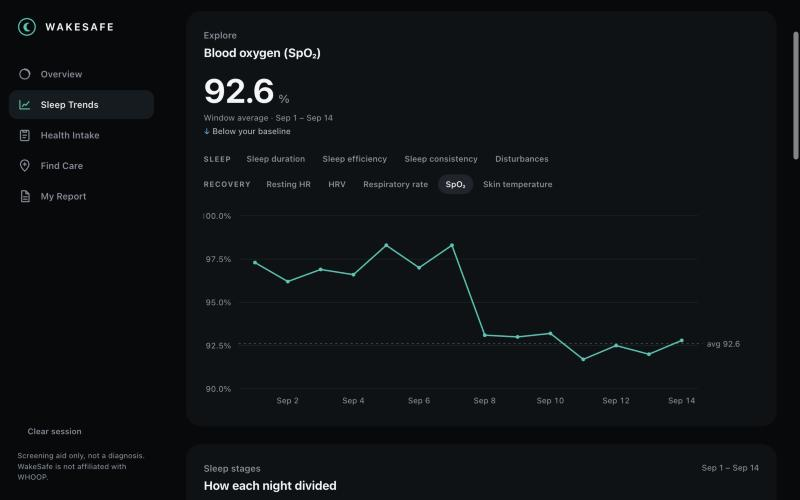

Pick any measure (sleep duration, efficiency, resting heart rate, HRV, breathing rate, SpO2, skin temperature) and see it night by night. In this example the person's blood oxygen drops from about 97% to about 92.6% around September 8. That kind of **change from a person's own normal** is exactly what WakeSafe looks for, because a wrist device is more trustworthy at spotting change than at measuring absolute values.

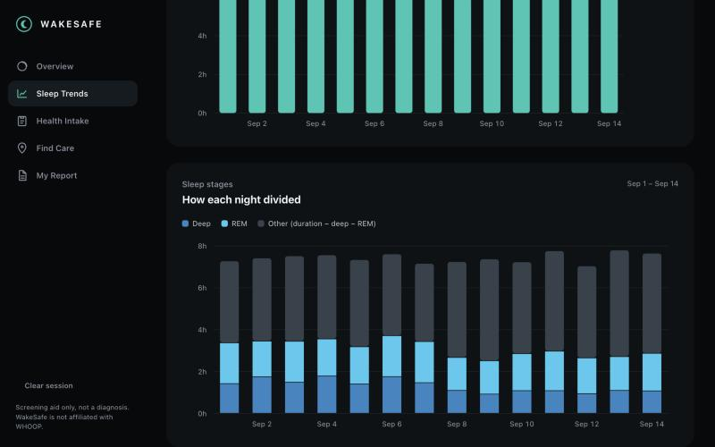

**Sleep stages** show how each night divided into deep sleep, REM sleep and other. Shaded or missing nights mean no data was recorded.

### Health Intake: answer the questionnaire

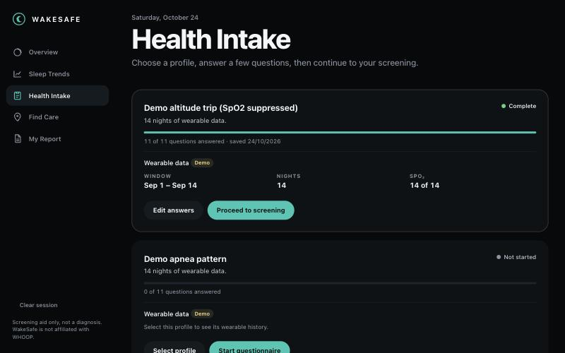

Each demo profile has a card showing its wearable data (date window, number of nights, how many nights have SpO2) and how far through the questionnaire it is. You can **Start questionnaire**, **Edit answers** or **Proceed to screening**.

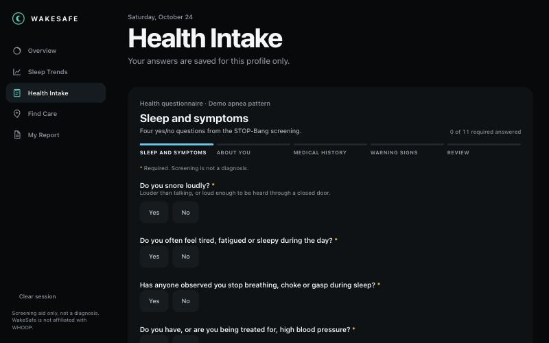

The questionnaire has five steps (Sleep and symptoms, About you, Medical history, Warning signs, Review) and 11 required questions. The first four are the well-known **STOP-Bang** screening questions: snoring, tiredness, observed breathing pauses and high blood pressure. Names and dates of birth are never asked.

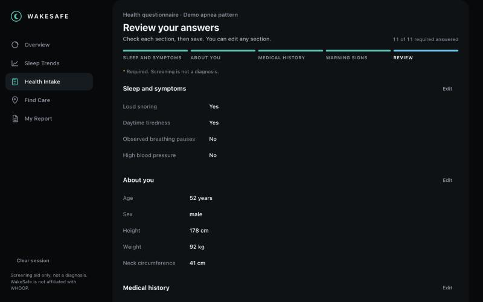

The **Review** step shows every answer so you can fix anything before saving. Answers are saved **on this device only** (browser storage), and the app reminds you not to enter real personal health information in the demo.

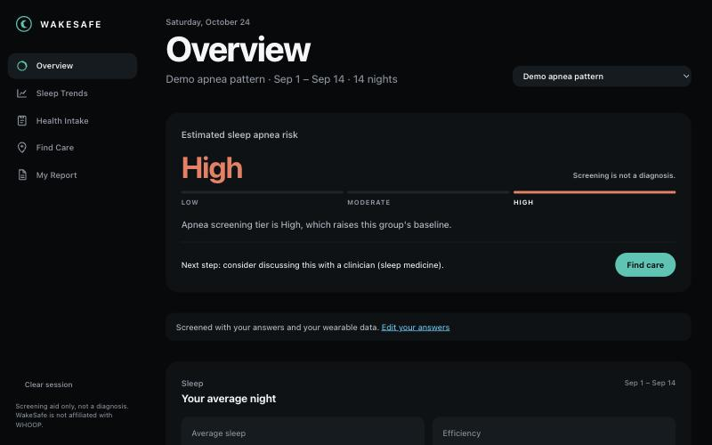

After saving, the screening **runs again with your answers**. The notice now reads "Screened with your answers and your wearable data", and the tier changed from Moderate to **High** because the questionnaire added points (snoring, tiredness, age over 50, a large neck and male sex). The app never shows a stale or invented result.

### Emergency warning signs always come first

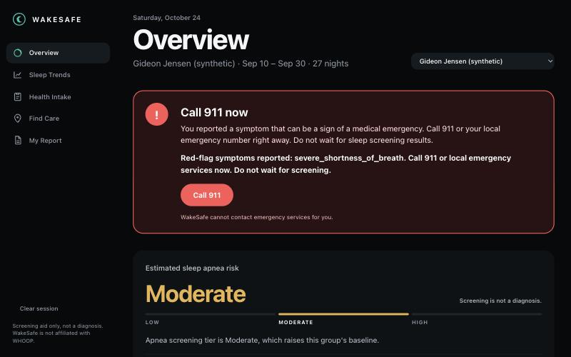

If someone reports chest pain, fainting, severe shortness of breath or stroke symptoms, the app shows a red **Call 911 now** banner above everything else, including the sleep result. These warning signs come **only from what the person reports**, never from wearable data, and they override all scoring. The app is clear that it cannot contact emergency services for you.

### Find Care and My Report

These two pages exist in the menu but are still marked "coming soon". The server side is ready (hospital ranking with a driving route on a map, and the report data), so only the screens remain. See [section 10](#10-what-is-not-built-yet).

---

## 2. How a result is produced

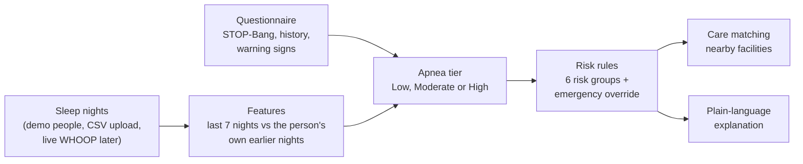

### Step 1: nights and a personal baseline

Each night is stored in one shared shape (`NightRecord`): resting heart rate, HRV, SpO2, breathing rate, skin temperature, sleep duration, deep and REM sleep, efficiency, disturbances and consistency. A missing reading stays **missing**. It is never filled in with zero.

The app compares the **last 7 nights** with the person's **own earlier nights** (up to 14). The result is a *z-score*: how many "usual wobbles" away from normal the recent average is. At least 14 nights are needed for this comparison. With fewer, the app says so instead of guessing.

### Step 2: the apnea tier (the rules you can read)

The tier is rule-based and every step is explained in the result:

1. **The questionnaire sets the starting tier.** STOP-Bang gives one point for each of eight items (snoring, tiredness, observed pauses, high blood pressure, BMI over 35, age over 50, neck over 40 cm, male sex). 0 to 2 is Low, 3 to 4 is Moderate and 5 to 8 is High. A Moderate score becomes High when at least two of the four symptom items are yes together with a large BMI, a large neck or male sex.
2. **The wearable can raise the tier by one level, never lower it.** A "signal" fires when a recent average is at least **1.0 standard deviation** away from the person's own earlier nights in a worrying direction: SpO2 lower, breathing rate higher, disturbances higher, or sleep efficiency lower. The tier rises only if **at least 2 signals fire together** and **at least one is a breathing signal** (SpO2 or breathing rate), because disturbances and poor sleep alone also happen with menopause, illness and travel.
3. **Travel is taken into account.** During an altitude trip, SpO2 and breathing-rate changes are not counted. During jet lag, disturbance and efficiency changes are not counted. The result says what was left out and why.
4. **The heart-rate model is a supporting note only.** A small model using resting heart rate and HRV is shown for context but does not change the tier (see [section 5](#5-the-model-and-its-honest-limits)).
5. **Too little data is stated clearly.** With fewer than 7 usable nights, wearable data is ignored and the evidence note says why.

All thresholds live in one settings block (`CONFIG` in `backend/app/services/screening/scoring.py`), are printed in each result's evidence note, and are marked **unreviewed by a clinician**.

### Step 3: risks, care and explanation

- **Risk rules** (`services/risks`) score six groups (sleep-disordered breathing, cardiovascular, metabolic, respiratory, short-term illness, menopause) with reasons and an evidence rating. The menopause group is not applied to a male profile.
- **Care matching** (`services/care`) ranks 20 Massachusetts hospitals by specialty fit and distance, and can draw a real driving route using OpenStreetMap, with no API key.
- **Explanations** (`services/explanations`) rewrite the structured results into plain sentences. They may only rephrase. They cannot add numbers, tiers or conditions, and a fixed template is used if anything fails.
- **Health nudges** (`services/nudges`) fetch current public respiratory-illness levels from the CDC and turn them into calm, one-action tips, with a cached fallback.

---

## 3. Safety rules built into the code

- **Screening language only.** No result says a person "has" a condition. Tests check the demo output for banned wording, and the explanation engine refuses to emit it.
- **Emergency override.** Red-flag symptoms come only from the person, force an **Urgent** result with 911 guidance, and `Urgent` never appears without them.
- **Every number is traceable.** Each reason carries the number it came from. An explanation may not introduce a new number.
- **Missing means missing.** A night without SpO2 shows "No data recorded", never 0.
- **Labels everywhere.** Synthetic data is labeled synthetic, simulated capacity is labeled simulated, and every value is tagged as patient-reported, wearable-measured, app-calculated or model-estimated.
- **No answer key leakage.** The made-up "true condition" of each demo person lives in a separate file that no app code reads (a test enforces this).
- **No accuracy claims on WHOOP data.** The model was trained on clinical recordings and has not been validated on WHOOP.
- **Privacy.** Questionnaire answers stay in the browser. No names or dates of birth are required. Nothing needs to be stored on a server.

---

## 4. The data

### Synthetic demo people (used for the demo and tests)

"Synthetic" means generated by a program. There are **72 demo people** in the picker:

| Group | How many | What they are |
| --- | --- | --- |
| P001 to P065 | 65 | Made-up people with about 30 nights each and made-up questionnaire answers, built by `synthetic_data/` (seed 42, so identical every run). They deliberately overlap, so it is not obvious who is who. Each has a random but fixed made-up name (for example "Nikhil Ortega (synthetic)") that matches the sex in their answers and is never based on health condition. |
| P901 | 1 | A demo-only person whose **last 7 nights get worse** (lower SpO2 and efficiency, more disturbances). It shows the app reacting to change. |
| Demo scenarios | 6 | Normal sleeper, apnea pattern, cardiovascular drift, peri/menopause pattern, altitude trip and jet-lag trip, built by `scripts/gen_synthetic.py`. The last two show travel being taken into account. |

Every synthetic file starts with a `# SYNTHETIC DATA` line and has an `is_synthetic` column.

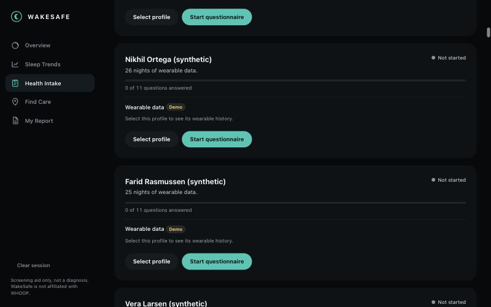

The demo people appear with their made-up names, a "(synthetic)" label and a "Demo" badge on their wearable data, so nobody can mistake them for real patients. Their IDs (P001 and so on) are used in the API and in the tests.

**Synthetic data is only used to run the demo, build the screens and test the code.** It is never used to train, tune or measure accuracy of any model.

### Real recordings (used to train the model)

The model learns only from open sleep-lab recordings: the **PhysioNet Apnea-ECG** database (70 overnight ECG recordings from 32 people). Raw files are downloaded into `ml/data/` and are **not** committed to git. See `ml/training/FEATURES.md` for exactly how nightly numbers are computed from them.

---

## 5. The model, and its honest limits

The runtime model is a small logistic regression on just two signals a wrist wearable also reports: **resting heart rate** and **HRV (RMSSD)**. It is stored as plain numbers in `backend/app/ml/apnea_resting_hr_rmssd.json`.

| Result | Value |
| --- | --- |
| Recordings used | 60 (40 apnea-group, 20 control-group) from 29 people |
| Validation | Leave-one-person-out: all recordings of one person are held out together |
| **AUROC** (0.5 is a coin flip, 1.0 is perfect) | **0.76** (95% confidence interval 0.57 to 0.92) |
| Sensitivity and specificity at the 0.5 cutoff | 0.70 and 0.75 |

Please read these limits before trusting any number:

1. **Domain shift.** It was trained on clinical ECG recordings and applied to wrist-wearable summaries. Accuracy on WHOOP data is **not claimed** and has not been measured.
2. **An easier test than real life.** The labels contrast people with 100 or more apnea minutes against people with fewer than 5, and borderline recordings were left out. Screening a general population is harder.
3. **Small sample.** The confidence interval is wide, and its low end is close to chance.
4. **Person grouping is inferred** from matching age, sex, height and weight in the dataset's own table.
5. **The score is not calibrated**, so it is never shown as a percentage.

Because of this, the model is a supporting note only. An earlier five-feature version scored higher (0.86) but needs ECG-only measurements that a wrist device does not report, so it is kept in `backend/app/ml/metrics.json` for comparison and labeled "not applicable to wearable data". An experimental gradient-boosting model (`ml/training/train_apnea_gbt.py`) is also in the repository but is not used by the app, and it validates per recording rather than per person, so treat its numbers as optimistic.

---

## 6. Run it yourself

You need **Python 3.11 or newer** and **Node 20.19+ or 22.12+**.

### 1) Backend (the server)

```bash
python3 -m venv .venv
source .venv/bin/activate
pip install -r requirements.txt
cd backend
python -m uvicorn app.main:app --port 8000
```

Open http://127.0.0.1:8000/docs for the interactive API page. No keys or accounts are needed. (Care routes and health nudges call free public services, OpenStreetMap routing and the CDC, and fall back to estimates or cached data if they are offline.)

### 2) Frontend (the website)

```bash
cd frontend
npm ci
# talk to the real server from step 1:
VITE_USE_MOCKS=false VITE_API_BASE_URL=http://127.0.0.1:8000 npm run dev
```

Open http://localhost:5173. Without those two settings the website runs on its own built-in sample data (`VITE_USE_MOCKS` defaults to `true`), which is handy for working on screens without the server.

| Setting | Meaning |
| --- | --- |
| `VITE_USE_MOCKS` | `true` (default): built-in sample data. `false`: call the real server. |
| `VITE_API_BASE_URL` | Server address when mocks are off, for example `http://127.0.0.1:8000`. |
| `VITE_SUPABASE_URL`, `VITE_SUPABASE_ANON_KEY` | Reserved for a planned cloud store, not connected. See `supabase/README.md`. Never put a service-role key here. |

### 3) Try it

1. Open the **Overview** and pick a demo person from the top right.
2. Open **Health Intake**, answer the questionnaire and save. The Overview re-screens with your answers.
3. Pick **Gideon Jensen (synthetic)** (ID P012) to see the emergency banner, or **Demo altitude trip (SpO2 suppressed)** to see travel being taken into account.

### Regenerating data (optional)

```bash
python scripts/gen_synthetic.py            # the six demo scenarios -> scripts/fixtures/
python synthetic_data/validate_synthetic.py # checks the 65 generated people
```

---

## 7. API reference

Interactive docs are at `/docs` while the server runs. The routes the website uses:

| Method and route | What it does |
| --- | --- |
| `GET /api/health` | Is the server up. |
| `GET /api/demo/personas` | The 72 demo people, each with made-up intake answers. |
| `POST /api/screening/analyze` | Body: `data_source` (`synthetic`, `csv` or `whoop`), `persona_id` or `csv_text`, optional `profile`. Returns features, apnea score, risk assessment, explanation, provenance and the nights. |
| `POST /api/care/recommendations` | Risk assessment plus location, returns ranked facilities. |
| `POST /api/care/map` | Same, with map pins and a driving route to the top facility. |
| `POST /api/reports/preview` | The structured clinician report data. |
| `POST /api/reports/pdf` | Not built yet (returns 501). |
| `GET /nudges` | Calm health tips from current CDC respiratory-illness data. |

Older short routes (`/health`, `/screen`, `/care`, `/explain`, `/report`, `/demo/{persona}`) still work.

Example:

```bash
curl -s -X POST http://127.0.0.1:8000/api/screening/analyze \
  -H 'Content-Type: application/json' \
  -d '{"data_source": "synthetic", "persona_id": "P001"}'
```

Uploading your own nightly CSV: send `"data_source": "csv"` and the file text in `csv_text`. The file needs a `date` column plus at least one measurement column (see `fixtures/nights_sample_P001.csv` for the format). Errors name the row and column but never echo values, and uploads are limited to 2 MB.

---

## 8. Repository layout

```
WakeSafe/
├── backend/             FastAPI server
│   └── app/
│       ├── api/         HTTP routes (thin adapters)
│       ├── models/      Shared data shapes (Pydantic), the team contract in code
│       ├── ml/          Small runtime model file + metrics
│       ├── data/        hospitals.csv
│       └── services/
│           ├── whoop/        Data providers: demo people, CSV upload, live WHOOP stub
│           ├── screening/    Features, STOP-Bang, the apnea tier rules
│           ├── risks/        Six risk groups and the emergency override
│           ├── care/         Facility ranking and driving routes
│           ├── explanations/ Plain-language explanations with safe fallbacks
│           └── nudges/       CDC-based health tips
├── frontend/            React + TypeScript website (installable as an app)
├── ml/                  Model training and evaluation (data downloads are gitignored)
├── synthetic_data/      Generator, validator and output for the 65 demo people
├── scripts/             Demo-scenario generator and hospital data builder
├── fixtures/            Small sample CSVs (including single-person upload samples)
├── supabase/            Planned cloud storage (not connected)
├── docs/                Notes, sanity checks and the screenshots above
└── TEAM_CONTRACTS.md    Agreed data shapes, ownership and safety rules
```

| Person | Area |
| --- | --- |
| Dhev | Data and apnea screening: `ml/`, `synthetic_data/`, `services/whoop`, `services/screening` |
| Helly | Risk engine, care matching, explanations, nudges and hospital data |
| Ee | Website, API routes, report, README, docs and slides |

---

## 9. Tests

| Suite | How to run | Status |
| --- | --- | --- |
| Backend (209) | `cd backend && python -m pytest -q` | all pass |
| ML and scripts | `python -m pytest ml/tests scripts/tests -q` | 24 pass, 3 skipped (they need the downloaded recordings) |
| Synthetic data (45) | `cd synthetic_data && python -m pytest -q` | all pass, validator 10 of 10 checks |
| Frontend (45) | `cd frontend && npm test` | all pass, `npm run build` succeeds |

Run the backend tests from the `backend/` folder. The tests cover the data providers, the apnea rules (including travel and the breathing-signal requirement), the emergency path, banned-wording checks, the API routes, and the website's questionnaire and result screens.

---

## 10. What is not built yet

- **Find Care and My Report pages.** The menu items exist and the server routes work, but the screens still say "coming soon".
- **PDF clinician report.** Report data is ready; PDF rendering is not.
- **Live WHOOP connection.** It needs OAuth credentials and member consent, so it currently fails with a clear message. CSV upload covers the same data.
- **Hospital capacity.** It is currently always "unknown". Using the licensed-bed counts directly would rank big hospitals ahead of much closer ones, so the ranking formula needs a design decision first.
- **Required disclaimer wording.** The exact sentence at the top of this README is not yet used verbatim on every result screen and in the risk and care text.
- **Cloud storage.** Questionnaire answers stay on the device. The Supabase migration and adapter are prepared but not connected, and the team still has to decide whether health answers should be stored at all.
- **Clinician review.** Every threshold in the rules is marked unreviewed and needs a clinician's check before real use.
- **A prospective check on real WHOOP data.** Nothing here has been tested on real people.

---

## 11. Future work

Where we want to take WakeSafe next. Each item says what exists today and what is missing.

### Doctor-ready reports

When the screener flags a risk, generate a clear report of the underlying metrics (sleep stages, heart rate, oxygen and trend data) and the person's relevant history, so they can bring it to a doctor and the doctor can analyze it quickly.

*Today:* the structured report data is built and served (`POST /api/reports/preview`), including the nights, features, reasons, versions and data provenance. *Next:* the **My Report** page, a printable PDF with trend charts and a nightly-values appendix, and a preview step before anything is downloaded, with name and date of birth optional.

### Smarter hospital matching

Recommend nearby hospitals with a specialty matched to the specific condition, ranked by urgency. For urgent cases, prioritize proximity and available capacity. For routine cases, weigh wait time and specialty fit, using live wait-time and bed-availability data from each hospital.

*Today:* 20 Massachusetts hospitals are ranked by specialty fit and drive time, with a driving route on the map, and capacity is labeled static, simulated, live or unknown. The live-capacity slot exists but is a stub. *Next:* real condition-to-specialty data (the current hospital list describes beds and services, not sleep clinics or cardiology), live wait-time and bed-availability feeds, and separate ranking rules for urgent and routine cases.

### Richer inputs and broader screening

Combine WHOOP data with additional sources, such as lab results and medical history, to improve the accuracy of our flagging. Use the same signals to screen for other cardiac issues, such as irregular heart rhythms, alongside sleep apnea.

*Today:* the inputs are WHOOP-format nightly summaries (demo people or CSV upload) plus an 11-question questionnaire, and the risk engine already has a cardiovascular group based on heart-rate and HRV trends. *Next:* the live WHOOP connection with member consent, a way to add lab results and fuller history, and heart-rhythm screening. Like everything in WakeSafe, a new screening signal would need validation on real recordings, a clinician's review and an honest statement of its limits before anyone relies on it.

---

*WakeSafe is a screening aid, not a diagnosis. Results come from wearable-style data and self-reported history, and must be confirmed by a clinician.*
